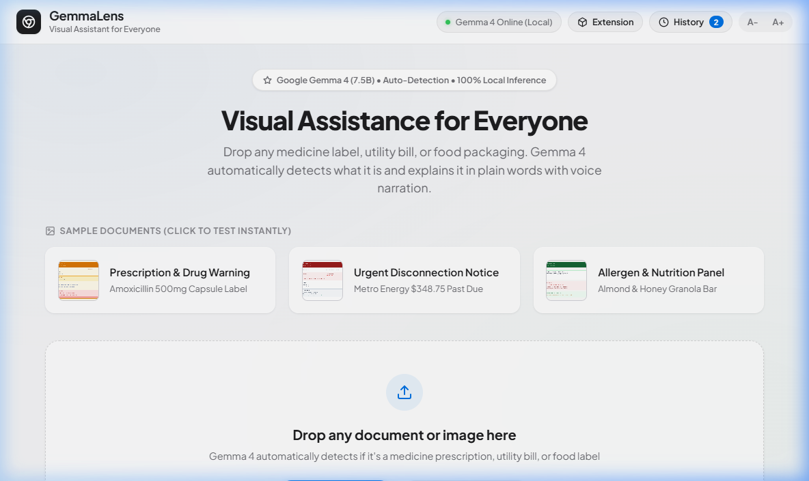
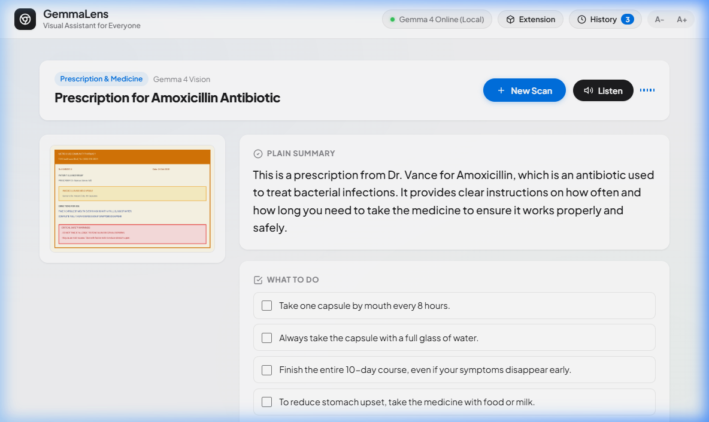
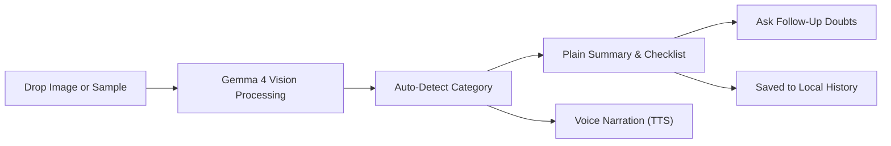
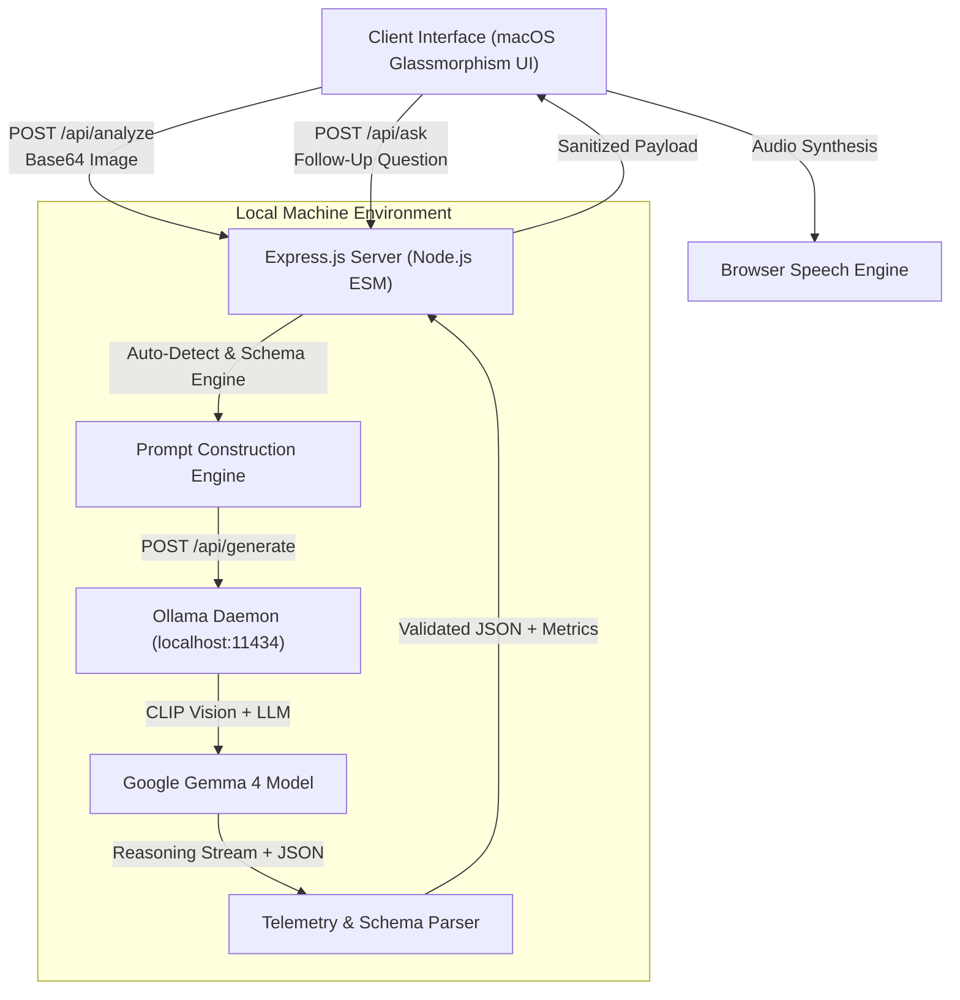

# GemmaLens — Universal Visual Assistant for Everyone

[](LICENSE)
[](https://hacktoberfest.com/)
[-black.svg)](https://ai.google.dev/gemma)
[](https://ollama.com/)
[](#7-chrome-extension-companion)

An open-source, local-first multimodal assistant powered by Google Gemma 4 (7.5B) running on Ollama. GemmaLens automatically detects and demystifies physical documents, medicine labels, utility bills, and food packaging into clear everyday language with one-click voice narration, follow-up Q&A, and persistent scan history.

---

## Interface Overview

| Home & Sample Gallery | Auto-Detected Analysis & Checklist |
| :---: | :---: |
|  |  |

---

## 1. What Does It Do, and For Whom?

Dense paperwork and intimidating packaging create everyday barriers for millions:
* **Patients and elderly citizens** struggle with small print on medicine containers, confusing dosing schedules, and unnoticed allergy contraindications.
* **Ordinary citizens and tenants** face high stress deciphering utility bills, disconnect notices, and administrative penalties.
* **Consumers and families** need immediate clarity on allergen warnings, cross-contamination statements, and hidden dietary risks.

**GemmaLens** eliminates manual mode selection. A user simply takes a photo, uploads an image, or clicks a preloaded sample document. The system **automatically classifies the document**, translates it into plain language, extracts key details, highlights essential action items, and reads the summary aloud via browser speech synthesis.

### Core Features
* **Intelligent Auto-Detection:** Automatically identifies whether an image is a prescription, utility bill, food allergen label, or general document.
* **Plain Language Summaries:** 5th-grade reading level explanations without clinical or bureaucratic jargon.
* **Interactive Action Checklist:** Clickable checkboxes to help users step through tasks (e.g. dosing schedule, bill payment, allergen checks).
* **Follow-Up Doubts & Q&A:** An interactive conversation module allowing users to ask further questions about the document (such as *"Can I take this with milk?"* or *"What happens if I miss the due date?"*).
* **Scan History Drawer:** Stores previous analyses in browser local storage for instant revisitation.
* **Verified Free Authoritative Links:** Curates direct reference links to official resources (such as MedlinePlus, FDA, and Benefits.gov) for verified information.
* **Voice-First Narration (TTS):** Browser-native speech synthesis reads explanations aloud for elderly or visually impaired users.
* **Clean Single-Screen Flow:** The dropzone and hero automatically hide during analysis, and a prominent **New Scan** button allows returning to the upload state at any time.

---

## 2. Open-Source AI Engine

GemmaLens relies entirely on open-source technologies with zero cloud dependencies:

* **Foundation Model:** **Google Gemma 4 (7.5B parameters, Q4_K_M)**
  * Native multimodal capability using a 478M parameter CLIP vision projector.
  * 131k context window for comprehensive document context.
  * Released under the Apache 2.0 license.
* **Local Inference Runtime:** **Ollama** (`localhost:11434`)
  * 100% private and offline-capable. Sensitive personal health documents and household bills never leave the local machine.
* **Cognitive Reasoning Transparency:**
  * Gemma 4's internal chain-of-thought tokens are captured and presented in an expandable technical inspection panel, demonstrating authentic reasoning rather than generic template matching.
* **Web Speech API:**
  * Uses the browser-native speech synthesis engine for accessible, natural audio narration.

---

## 3. System Architecture & Workflow

### User Experience Flow



### Technical Architecture



---

## 4. Local Setup & Running Instructions

### System Requirements
* **Node.js:** v18.0.0 or higher
* **Ollama:** Installed and running locally ([Download Ollama](https://ollama.com/download))
* **Gemma 4 Model:** Pulled in Ollama:
  ```bash
  ollama run gemma4
  ```

### Step 1: Clone the Repository
```bash
git clone https://github.com/Carbon-7/HacktoberFest-26.git
cd HacktoberFest-26
```

### Step 2: Install Dependencies
```bash
npm install
```

### Step 3: Launch the Application
```bash
npm start
```

Open your browser to:
```
http://localhost:3000
```

> **Evaluation Tip:** On first load, click any of the **Sample Documents** on the home screen (*Prescription*, *Utility Notice*, or *Allergen Label*) to test live Gemma 4 vision inference immediately without uploading personal files.

---

## 5. Chrome Extension Companion (Manifest V3)

GemmaLens includes a companion browser extension in the [`extension/`](extension/) directory, empowering users to snapshot, select, and demystify any webpage (medical portals, utility dashboards, fine-print terms, or product labels) with continuous follow-up Q&A:

### Key Companion Features
* **Select Specific Zone (Area Snip):** Click **Select Specific Zone** to activate a precision crosshair overlay on your active tab. Drag a crop box over any paragraph, legal clause, billing row, or label to analyze just that section.
* **Full Webpage Snapshot:** 1-click capture of the entire visible webpage.
* **In-Extension Continuation Q&A:** Ask follow-up questions directly inside the extension popup (*"What is the penalty if I pay next week?"* or *"Can I take this with milk?"*).
* **Local Scan History:** Revisit past webpage and zone scans with full summaries and continuation threads stored privately in browser storage.
* **Dynamic Audio Narration:** Browser-native speech synthesis with synchronized visual soundwave bars.

### Installation (Two Methods)

#### Option A: 1-Click In-App Download
1. In the GemmaLens web app header at `http://localhost:3000`, click the **Extension** button.
2. Click **Download Extension (.ZIP)** to get `gemmalens-extension.zip`.
3. Extract the zip to any folder.
4. In Chrome/Brave/Edge, navigate to `chrome://extensions`, enable **Developer mode**, click **Load unpacked**, and select the extracted folder.

#### Option B: Load Directly from Repository
1. In Chrome/Brave/Edge, navigate to `chrome://extensions/`.
2. Enable **Developer mode** (top-right toggle).
3. Click **Load unpacked** and select the [`extension/`](extension/) folder directly from this repository.
4. While browsing any website, click the GemmaLens icon to explain the full page or snip a specific area.

---

## 6. Project Directory Structure

```
HacktoberFest-26/
├── LICENSE                 # MIT Open-Source License
├── README.md               # Comprehensive project documentation
├── package.json            # Project manifest and scripts
├── .gitignore              # Git exclusions for dependencies and internal trackers
├── extension/              # Chrome extension companion (Manifest V3)
│   ├── manifest.json       # Extension manifest (activeTab, scripting, storage)
│   ├── background.js       # Background service worker coordinating tab captures
│   ├── crop.js             # In-page crosshair area selection and floating HUD
│   ├── popup.html          # macOS frosted glass popup interface
│   ├── popup.js            # Capture, zone crop, continuation Q&A, and history controller
│   └── icon.png            # Extension icon
├── src/
│   └── server/
│       ├── index.js        # Express application server and static hosting
│       ├── ollamaClient.js # Local Ollama HTTP bridge and schema parser
│       ├── prompts.js      # Structured system prompts and mode definitions
│       └── presetsData.js  # Sample document metadata and image loaders
├── public/
│   ├── index.html          # Semantic, accessible macOS glassmorphism interface
│   ├── css/
│   │   └── style.css       # Clean neutral stylesheet with frosted glass styling
│   ├── js/
│   │   ├── app.js          # Client controller, ingestion, and results renderer
│   │   └── audio.js        # Audio engine with boundary-driven speech soundwaves
│   └── assets/
│       ├── presets/        # High-resolution sample document images
│       └── gemmalens-extension.zip # Packaged Chrome extension for 1-click download
└── docs/
    └── screenshots/        # Application interface captures
```

---

## 7. Design System & Accessibility

* **macOS-Inspired Glassmorphism:** Clean, neutral palette with frosted glass cards (`rgba(255, 255, 255, 0.78)` with `backdrop-filter: blur(24px)`), soft shadows, and clean buttons.
* **Zero Visual Clutter:** No emojis or AI jargon. Employs crisp monochrome SVG stroke icons and legible typography.
* **Audio-Reactive Soundwave:** Dynamic visual equalizer heights driven by real Web Speech API boundary events, pulsing with speech cadence and resting cleanly at baseline during pauses.
* **Unified Theme Palette:** Pure Apple System Blue (`#0071E3`) and neutral slate tokens across loading indicators, progress tracks, and interactive badges.
* **Adjustable Typography:** Dynamic text scaling controls (`A-` and `A+`) allow instant resizing of the interface for low-vision and elderly users.
* **Interactive Checklist:** Action items feature clickable checkboxes to support cognitive clarity and task tracking.
* **Scan History & New Scan Reset:** Easily revisit previous scans via the history drawer or start fresh with a single click.

---

## 8. Authors & Credits

* **Maintainer & Author:** [HacktoberFest-26 Team](https://github.com/Carbon-7/HacktoberFest-26)
* **Event:** Hacktoberfest Hack Day 2026 (Major League Hacking)
* **Model:** Google Gemma 4 (Google DeepMind)
* **Local Inference:** Ollama Project
* **Dependencies:** Express.js, CORS

---

## 9. License

This project is licensed under the **MIT License** — see the [LICENSE](LICENSE) file for details.

