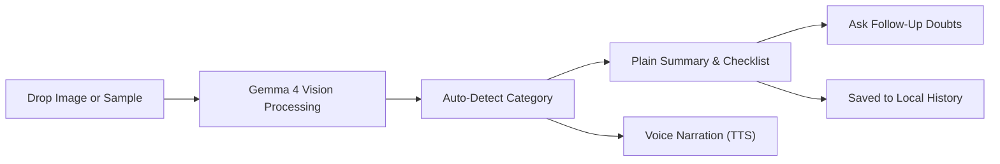
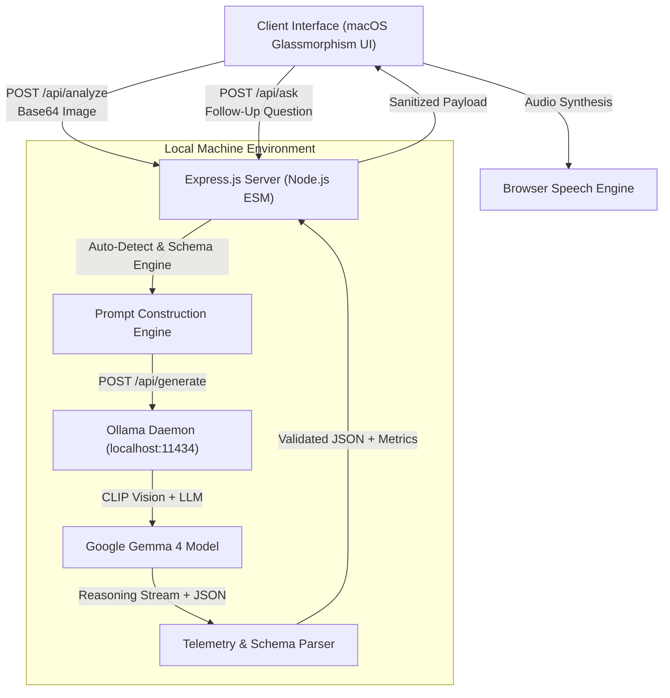

# GemmaLens — Universal Visual Assistant for Everyone

[](LICENSE)
[](https://hacktoberfest.com/)
[-black.svg)](https://ai.google.dev/gemma)
[](https://ollama.com/)
[](#7-chrome-extension-companion)

An open-source, local-first multimodal assistant powered by Google Gemma 4 (7.5B) running on Ollama. GemmaLens automatically detects and demystifies physical documents, medicine labels, utility bills, and food packaging into clear everyday language with one-click voice narration, follow-up Q&A, and persistent scan history.

---

## Interface Overview

| Home & Sample Gallery | Auto-Detected Analysis & Checklist |
| :---: | :---: |
|  |  |

---

## 1. What Does It Do, and For Whom?

Dense paperwork, confusing packaging, and intimidating technical diagrams create everyday barriers for millions:
* **Patients and elderly citizens** struggle with small print on medicine containers, confusing dosing schedules, and unnoticed allergy contraindications.
* **Ordinary citizens and tenants** face high stress deciphering utility bills, disconnect notices, and administrative penalties.
* **Consumers and families** need immediate clarity on allergen warnings, cross-contamination statements, and hidden dietary risks.
* **Developers, students, and travelers** need instant, grounded visual explanations for architecture schematics, foreign transit maps, math proofs, and balance sheets.

**GemmaLens** eliminates manual mode selection. A user simply drops a PDF document, image, or snapshot. The system **automatically classifies the domain**, translates it into plain language, extracts key details, highlights essential action items, and reads the summary aloud via browser speech synthesis.

### The X-Factor: Why GemmaLens Surpasses Generic Chat Apps
Why use GemmaLens instead of pasting into a generic cloud chatbot?

| Feature | Generic Cloud Chat Apps (ChatGPT / Claude) | GemmaLens Universal Visual Assistant |
| :--- | :--- | :--- |
| **Data Privacy & Compliance** | Cloud data leakage; exposes confidential prescriptions, bank accounts, and tax forms to external servers. | **100% Local Inference:** Powered by Google Gemma 4 on local Ollama (`localhost:11434`). Zero cloud dependencies; sensitive documents never leave your device. |
| **User Experience & Output** | Wall of text; requires typing prompts and manual reading. | **Action-Oriented Cognitive Layout:** Automatic classification, interactive checklist with checkboxes, severe warning banners, and key metric cards. |
| **Browser Integration** | Requires switching tabs, saving screenshots, and uploading files. | **Native Chrome Side Panel Companion:** Docks right next to your active tab with a **Resizable Snipping Tool** to crop any specific paragraph, chart, or bill line with live sync to the main app. |
| **Accessibility & Narration** | Static robotic voice or none. | **Speech-Reactive Soundwave:** Web Speech API boundary-driven audio equalizer with live rhythm tracking, custom voice picker, and speed/pitch tuning. |
| **Document Support** | Limited image uploads. | **High-DPI PDF & Multi-Format:** Native in-browser PDF rendering via PDF.js for crisp character recognition on multipage documents. |
| **Civic & Regional Grounding** | Generic hallucinated advice. | **Contextual Civic Routing:** Recommends verified local support bodies (e.g. LIHEAP energy assistance, NHS advice, CFPB consumer complaints, MedlinePlus). |

### Multi-Domain Intelligence Roles
GemmaLens dynamically adapts its cognitive role based on the visual input:
1. **Prescription & Medicine:** Extracts dosing, timing, severe contraindications, and food instructions.
2. **Financial, Utility & Legal Simplifier:** Dissects complex contracts, eviction warnings, and payment penalties, linking to regional aid bodies.
3. **Developer & System Architecture Tutor:** Explains error stack traces, database ERDs, terminal logs, and system schematics.
4. **Academic & Intuitive Tutor:** Transforms complex math formulas, physics diagrams, and textbook pages into step-by-step intuitive analogies.
5. **Trip Planner & Local Transit Guide:** Translates foreign subway maps, street signs, and restaurant menus with dietary warnings.
6. **Stocks & Markets Interpreter:** Summarizes quarterly earnings slides, balance sheets, candlestick patterns, and financial risk disclosures.
7. **Food & Allergen Safety Lens:** Flags allergen cross-contamination and nutritional highlights.

---

## 2. Open-Source AI Engine

GemmaLens relies entirely on open-source technologies with zero cloud dependencies:

* **Foundation Model:** **Google Gemma 4 (7.5B parameters, Q4_K_M)**
  * Native multimodal capability using a 478M parameter CLIP vision projector.
  * 131k context window for comprehensive document context.
  * Released under the Apache 2.0 license.
* **Local Inference Runtime:** **Ollama** (`localhost:11434`)
  * 100% private and offline-capable. Sensitive personal health documents and household bills never leave the local machine.
* **Cognitive Reasoning Transparency:**
  * Gemma 4's internal chain-of-thought tokens are captured and presented in an expandable technical inspection panel, demonstrating authentic reasoning rather than generic template matching.
* **Web Speech API:**
  * Uses the browser-native speech synthesis engine for accessible, natural audio narration.

---

## 3. System Architecture & Workflow

### User Experience Flow



### Technical Architecture



---

## 4. Local Setup & Running Instructions

### System Requirements
* **Node.js:** v18.0.0 or higher
* **Ollama:** Installed and running locally ([Download Ollama](https://ollama.com/download))
* **Gemma 4 Model:** Pulled in Ollama:
  ```bash
  ollama run gemma4
  ```

### Step 1: Clone the Repository
```bash
git clone https://github.com/Carbon-7/HacktoberFest-26.git
cd HacktoberFest-26
```

### Step 2: Install Dependencies
```bash
npm install
```

### Step 3: Launch the Application
```bash
npm start
```

Open your browser to:
```
http://localhost:3000
```

> **Evaluation Tip:** On first load, click any of the **Sample Documents** on the home screen (*Prescription*, *Utility Notice*, or *Allergen Label*) to test live Gemma 4 vision inference immediately without uploading personal files.

---

## 5. Chrome Side Panel Companion (Manifest V3)

GemmaLens includes a companion browser extension in [`extension/`](extension/) built on the modern Chrome **Side Panel API**. It docks directly alongside your active webpage, providing instant visual intelligence, resizable snipping, and seamless two-way session synchronization with the GemmaLens desktop app:

### Key Companion Capabilities
* **Native Chrome Side Panel:** Opens as a persistent sidebar right next to your active webpage without blocking content.
* **Interactive Resizable Snipping Tool (`crop.js`):** Click **Resizable Snipping Tool** to activate an on-page snipping interface with 8 resize handles. Drag, reposition, and resize the selection box around any paragraph, fine-print clause, terminal error, or chart, then click **Analyze Selected Zone**.
* **1-Click Open & Sync in GemmaLens App:** Click **Open & Sync in App** inside the side panel to securely transfer the active document, extracted details, and checklist directly into the full-screen desktop interface via the `/api/sync-session` bridge.
* **In-Panel Continuation Q&A:** Ask questions in real-time about the page or snipped section (*"Does this clause allow early cancellation?"* or *"What is the syntax error on line 42?"*).
* **Local Scan History:** Privately stores past page and zone scans with one-click restore in browser local storage.
* **Side-by-Side Audio Narration:** Listens to plain explanations while reading along with dynamic soundwave feedback.

### Installation Instructions
1. In the GemmaLens web app header at `http://localhost:3000`, click the **Side Panel** button.
2. Click **Download Extension (.ZIP)** to download `gemmalens-extension.zip`.
3. Extract the ZIP archive to any local directory (or use the [`extension/`](extension/) directory directly from this repository).
4. In Chrome/Brave/Edge, navigate to `chrome://extensions`, enable **Developer mode** (top-right toggle), click **Load unpacked**, and select the extracted folder.
5. Click the GemmaLens icon in your browser toolbar to dock the Side Panel beside any webpage.

---

## 6. Project Directory Structure

```
HacktoberFest-26/
├── LICENSE                 # MIT Open-Source License
├── README.md               # Comprehensive project documentation & benchmarks
├── package.json            # Project manifest and scripts
├── .gitignore              # Git exclusions for dependencies and internal trackers
├── extension/              # Chrome Side Panel companion (Manifest V3)
│   ├── manifest.json       # SidePanel, activeTab, scripting, and storage permissions
│   ├── background.js       # Background service worker coordinating sidepanel & snipping
│   ├── sidepanel.html      # macOS frosted glass side panel markup
│   ├── sidepanel.js        # Side panel controller, analysis engine & app sync
│   ├── crop.js             # 8-handle resizable snipping tool & in-page floating HUD
│   ├── popup.html          # Fallback extension popup
│   ├── popup.js            # Popup controller
│   └── icon.png            # High-resolution extension icon
├── src/
│   └── server/
│       ├── index.js        # Express server, static hosting & /api/sync-session bridge
│       ├── ollamaClient.js # Local Ollama HTTP bridge, streaming & schema parser
│       ├── prompts.js      # Multi-domain prompts (health, legal, code, tutor, stocks)
│       └── presetsData.js  # Sample document metadata and image loaders
├── public/
│   ├── index.html          # Semantic, accessible macOS glassmorphism interface
│   ├── favicon.svg         # Modern Apple-style lens favicon
│   ├── css/
│   │   └── style.css       # Clean stylesheet with themes (Light, OLED, High-Contrast, Warm)
│   ├── js/
│   │   ├── app.js          # App controller, PDF.js renderer, settings & sync engine
│   │   └── audio.js        # Boundary-driven speech engine with live soundwave physics
│   └── assets/
│       ├── presets/        # High-resolution sample document images
│       └── gemmalens-extension.zip # Packaged Chrome extension for 1-click download
└── docs/
    └── screenshots/        # Application interface captures
```

---

## 7. Design System & Accessibility

* **macOS-Inspired Glassmorphism:** Clean, neutral palette with frosted glass cards (`rgba(255, 255, 255, 0.78)` with `backdrop-filter: blur(24px)`), soft shadows, and clean buttons.
* **Zero Visual Clutter:** No emojis or AI jargon. Employs crisp monochrome SVG stroke icons and legible typography.
* **Audio-Reactive Soundwave:** Dynamic visual equalizer heights driven by real Web Speech API boundary events, pulsing with speech cadence and resting cleanly at baseline during pauses.
* **Unified Theme Palette:** Pure Apple System Blue (`#0071E3`) and neutral slate tokens across loading indicators, progress tracks, and interactive badges.
* **Adjustable Typography:** Dynamic text scaling controls (`A-` and `A+`) allow instant resizing of the interface for low-vision and elderly users.
* **Interactive Checklist:** Action items feature clickable checkboxes to support cognitive clarity and task tracking.
* **Scan History & New Scan Reset:** Easily revisit previous scans via the history drawer or start fresh with a single click.

---

## 8. Authors & Credits

* **Maintainer & Author:** [HacktoberFest-26 Team](https://github.com/Carbon-7/HacktoberFest-26)
* **Event:** Hacktoberfest Hack Day 2026 (Major League Hacking)
* **Model:** Google Gemma 4 (Google DeepMind)
* **Local Inference:** Ollama Project
* **Dependencies:** Express.js, CORS

---

## 9. License

This project is licensed under the **MIT License** — see the [LICENSE](LICENSE) file for details.

