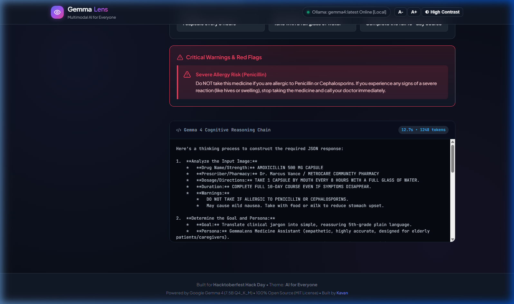
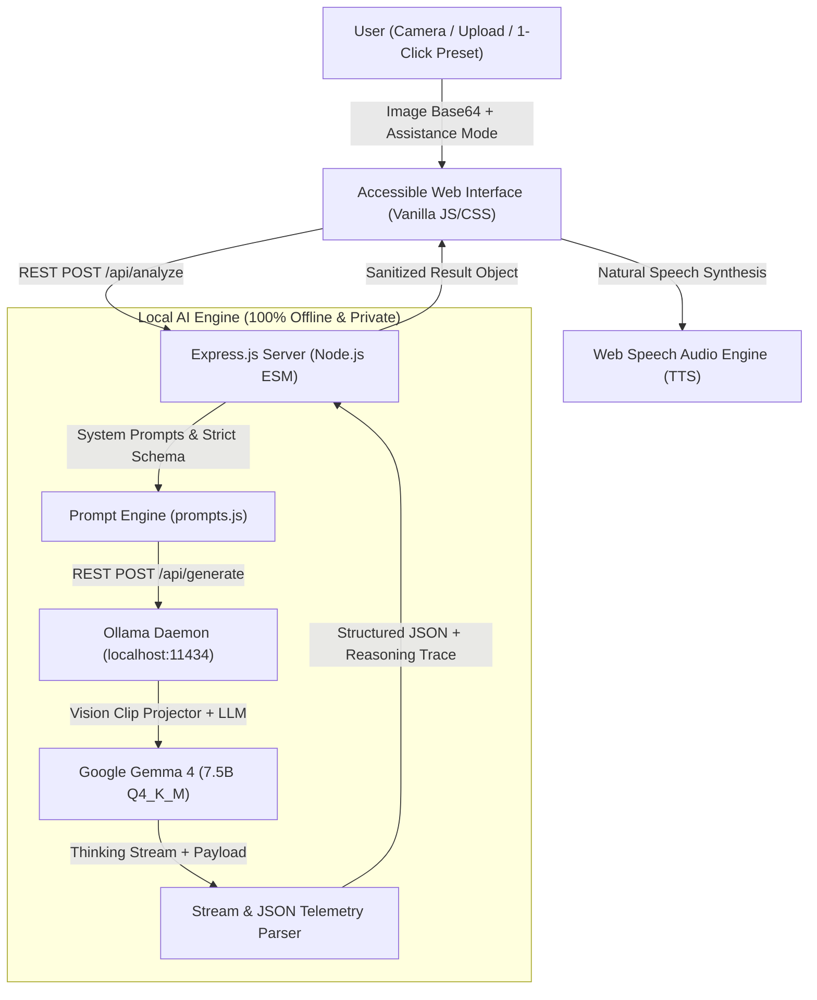

# 👁️ GemmaLens — Multimodal Visual Assistant for Everyone

[](LICENSE)
[](https://hacktoberfest.com/)
[-4F46E5.svg)](https://ai.google.dev/gemma)
[-10B981.svg)](https://ollama.com/)
[](#accessibility--human-design)

> **"Demystifying the physical and written world in plain language and spoken voice for patients, seniors, and everyday citizens."**

---

## 📸 Interface & Live Evaluation

| 🏠 Home & Preset Gallery | 📊 Multimodal Analysis & Checklist | 🧠 Cognitive Reasoning Chain |
| :---: | :---: | :---: |
|  |  |  |

---

## 🎯 What does it do, and for whom?

Millions of people face daily anxiety when trying to understand critical physical documents:
* **Elderly patients** struggle to read tiny medicine bottles, decipher complex dosage schedules, and identify life-threatening contraindications.
* **Ordinary citizens & tenants** are intimidated by obscure utility bills, threatening disconnect notices, and bureaucratic fine print.
* **Allergy sufferers & families** risk severe medical emergencies trying to spot hidden allergens, cross-contamination warnings, and toxic additives on grocery packaging.

**GemmaLens** turns any smartphone camera, webcam, or uploaded image into an **instant, empathetic, plain-language assistant** that explains what matters in simple 5th-grade words and **reads it aloud via voice narration**:

1. 💊 **Medicine & Rx Lens:** Identifies drug name, exact dosage schedule (e.g. *"every 8 hours with water"*), and flags severe contraindications (e.g. penicillin allergies).
2. 📄 **Bills & Civic Demystifier:** Cuts through bureaucratic jargon to highlight the bottom line: *Total Amount Due*, *Strict Deadline*, late penalties, and a step-by-step checklist to avoid service shut-off.
3. 🥗 **Food & Allergen Watchdog:** Scans ingredient panels to warn against common allergens (nuts, dairy, gluten, soy) and facility cross-contamination risks.
4. 🔊 **Voice-First Narration (Web Speech API):** 1-click audio read-aloud with pacing tuned for elderly ears and visually impaired users.
5. ⚡ **1-Click Judge Presets:** Preloaded high-resolution samples allow judges and users to evaluate live inference in seconds without uploading personal files.

---

## 🤖 Which open-source AI does it use?

GemmaLens is engineered around the **Triple-Threat Open-Source AI Stack**:

1. **Open-Weight Core Model:** **Google Gemma 4 (7.5B Q4_K_M)**
   * Utilizes Gemma 4's native multimodal architecture with a `clip` vision projector (478M params) and a 131k context window.
   * Runs under the permissive **Apache 2.0 license**.
2. **Cognitive Transparency (Thinking Mode):**
   * Exposes Gemma 4's native internal chain-of-thought reasoning (`thinking: true`) via an interactive UI accordion. Users and judges can inspect the model's exact step-by-step cognitive deduction before the final output.
3. **100% Local Inference Engine (Ollama):**
   * Runs on `localhost:11434` with **zero cloud dependencies, zero API costs, and zero data telemetry**. Sensitive medical prescriptions and private utility bills never leave the user's personal device.
4. **Resilient Agent Pipeline:**
   * Structured prompt templates enforce 5th-grade readability, schema validation, and defensive JSON repair algorithms.

---

## 🏗️ System Architecture



---

## 🚀 How do I run it?

### Prerequisites
1. **Node.js** (v18.0 or higher)
2. **Ollama** installed on your system ([Download Ollama](https://ollama.com/download))
3. **Gemma 4** model pulled in Ollama:
   ```bash
   ollama run gemma4
   ```

### 1. Clone the Repository
```bash
git clone https://github.com/Kavan/HacktoberFest-26.git
cd HacktoberFest-26
```

### 2. Install Dependencies
```bash
npm install
```

### 3. Start GemmaLens
```bash
npm start
```

Open your browser at **`http://localhost:3000`**.

> **💡 Quick Demo Tip for Judges:**
> Click any of the **1-Click Evaluation Presets** on the home screen (*Prescription & Drug Warning*, *Urgent Disconnection Notice*, or *Allergen & Nutrition Panel*) to watch Gemma 4 analyze the image live!

---

## ♿ Accessibility & Human Design (`DESIGN.md`)

* **WCAG 2.1 AAA Compliant Contrast:** High-contrast dark theme by default reduces visual fatigue for low-vision users.
* **Dynamic Typography Scaling:** Integrated `A-` and `A+` controls to instantly adjust base font size without zooming the browser viewport.
* **One-Click High Contrast Mode:** Inverts surfaces to pure black/white for maximum daylight legibility.
* **Interactive Action Checklists:** Users can check off steps as they complete them to reduce cognitive overwhelm.
* **Zero External Font/Icon Dependencies:** All icons are inline SVGs, ensuring instantaneous load times even on spotty internet connections.

---

## 📁 Repository Structure

```
HacktoberFest-26/
├── DESIGN.md                 # Design system, tokens, typography, and accessibility guidelines
├── ARCHITECTURE.md           # System data flow, API contracts, and resilience patterns
├── MEMORY.md                 # Project state, agent continuity, and environment specs
├── TASK.md                   # Granular milestone and task checklist
├── LICENSE                   # MIT Open-Source License
├── package.json              # Project configuration and lightweight dependencies
├── server/
│   ├── index.js              # Express API server & static asset host
│   ├── ollamaClient.js       # Ollama daemon connector, health check, and thinking parser
│   ├── prompts.js            # Mode-specific 5th-grade system prompts and JSON schemas
│   └── presetsData.js        # High-resolution sample preset metadata and image loaders
├── public/
│   ├── index.html            # Semantic, accessible single-page interface
│   ├── css/style.css         # Custom property styling, gradients, and micro-animations
│   ├── js/
│   │   ├── app.js            # Application controller, camera handler, and UI state
│   │   └── audio.js          # Web Speech API audio narration engine
│   └── assets/
│       └── presets/          # Preloaded high-resolution evaluation documents
└── docs/
    └── screenshots/          # High-resolution interface captures for documentation
```

---

## 👥 Authors & Credits

* **Kavan** — Project Creator & Maintainer • [GitHub (@Kavan)](https://github.com/Kavan)
* **Built for:** Hacktoberfest Hack Day 2026 (Major League Hacking)
* **Core Model:** Google Gemma 4 (Google DeepMind / Google AI)
* **Local Inference:** Ollama Team
* **Open Source Libraries:** Express.js, CORS

---

## 📄 License

This project is licensed under the **MIT License** — see the [LICENSE](LICENSE) file for complete details.
